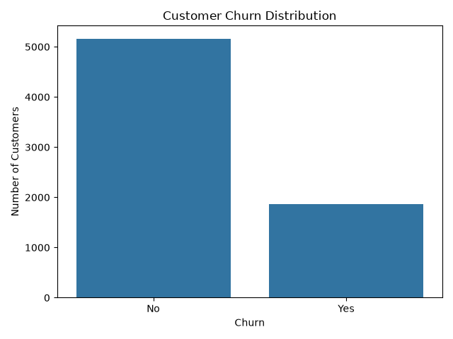
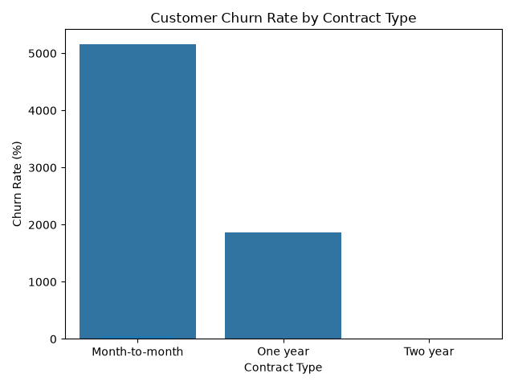
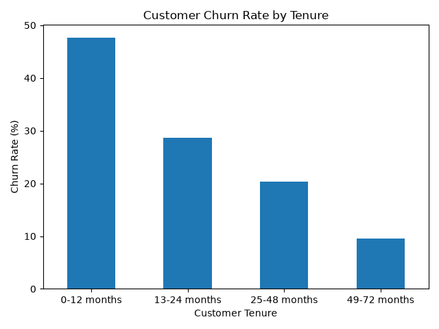
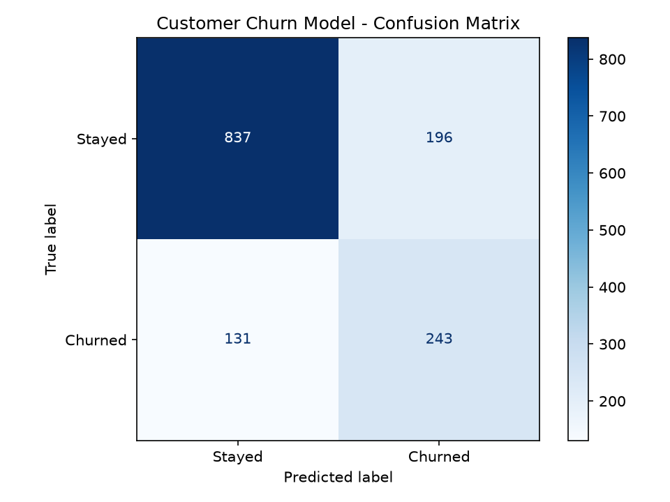
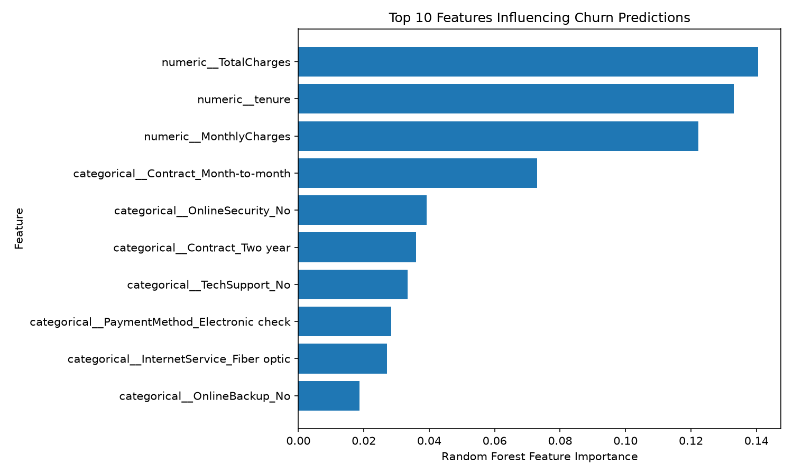

# Customer-Churn-Analysis
End-to-end customer churn analysis using Python, data visualization, statistical analysis, and machine learning.
## Key Findings and Business Recommendations

### Model Performance

The Random Forest classifier achieved the following results on the held-out test set:

- **Accuracy:** 76.76%
- **Precision:** 55.35%
- **Recall:** 64.97%
- **F1-score:** 59.78%
- **ROC-AUC:** 81.53%

The model identifies approximately 65% of customers who churned in the test set. Its predictions can support customer-retention analysis, but they should not be treated as definitive predictions.

### Feature Importance

The ten highest-ranked features in the Random Forest model were:

1. TotalCharges
2. Tenure
3. MonthlyCharges
4. Month-to-month contract
5. No online security
6. Two-year contract
7. No tech support
8. Electronic check payment
9. Fiber optic internet
10. No online backup

TotalCharges, tenure, and MonthlyCharges had the highest feature-importance scores in the trained model.

### Business Recommendations

- **Review early customer retention:** Examine churn rates among newer customers and consider targeted onboarding and support.
- **Review contract options:** Investigate whether customers on month-to-month contracts have higher churn rates than customers on longer-term contracts.
- **Evaluate service support:** Examine whether customers without online security or technical support have different churn rates.
- **Review pricing and billing:** Investigate customer feedback, monthly charges, and payment experiences to identify potential retention opportunities.
- **Measure campaign effectiveness:** Test retention initiatives and compare churn outcomes before and after interventions.

These recommendations are hypotheses for further investigation. Feature importance measures how the trained model uses features; it does not establish causation or guarantee that changing a feature will reduce churn.

### Limitations

The model's precision and recall indicate that some predictions are incorrect. Further work could include threshold tuning, cross-validation, hyperparameter tuning, and comparison with baseline models before deployment.

## Visual Results

### 1. Customer Churn Distribution

### 2. Churn Rate by Contract Type

### 3. Churn Rate by Customer Tenure

### 4. Machine Learning Confusion Matrix

### 5. Feature Importance

